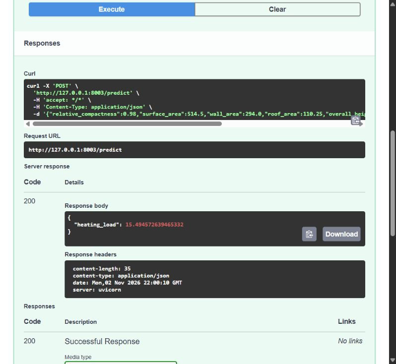

# Heating Load prediction

This is an end-to-end ML engineering project that predicts building **Heating Load (Y1)** from eight geometry and glazing characteristics in the UCI Energy Efficiency dataset. It covers exploratory analysis, model comparison, hyperparameter tuning and evaluation, with the selected pipeline served through FastAPI and Docker. Predictions describe simulated buildings; the model has not been validated for real-building design.

## Data and approach

The included `data/ENB2012_data.xlsx` is the original UCI Energy Efficiency dataset, by Tsanas & Xifara (2012). If needed, download the workbook from the [dataset page](https://archive.ics.uci.edu/dataset/242/energy+efficiency) and place it in `data/`.

There are 768 observations, eight predictors, and no missing or duplicate rows. Only Y1 is modelled; Y2 is excluded. Target values are reported in dataset units without assuming energy units.

1. Reserve 20% for testing (614 training rows, 154 test rows; seed 42).
2. Explore training distributions, correlations and feature/target relationships in the notebook.
3. Compare Linear Regression, Decision Tree, Random Forest and XGBoost using five shuffled training folds.
4. Tune Random Forest (depth and leaf size) and XGBoost (depth, learning rate and tree count) with small grids.
5. Select by mean CV RMSE, fit on the 614 training rows and evaluate once on the held-out test set.

Categorical orientation and glazing-distribution codes are one-hot encoded. Continuous features are standardized for Linear Regression. Preprocessing stays inside each model pipeline and each CV fold, preventing leakage. The saved model remains fitted on the training partition; it is not refitted on test rows.

## Results

Results from the reproducible training pipeline. Lower RMSE is better; SD is variation across five folds.

| Model | Initial CV RMSE ± SD | Tuned CV RMSE |
|---|---:|---:|
| Linear Regression | 2.8285 ± 0.1235 | — |
| Decision Tree | 0.6472 ± 0.1113 | — |
| Random Forest | 0.5359 ± 0.0340 | 0.5281 |
| XGBoost | 0.4358 ± 0.0276 | **0.3986** |

The selected XGBoost uses **300 trees, depth 4 and learning rate 0.1**. Its test **RMSE is 0.4039**, **MAE is 0.2896**, and **R² is 0.9984**. Selection used CV scores, not these test scores. Tuning CV scores are selection estimates, not independent performance estimates. Full-precision results and selected parameters are in `results.json`.

Relative compactness and glazing are useful signals; correlated geometry variables make individual importance difficult to interpret. The notebook includes prediction/residual plots and post-selection permutation importance. That explanation is not used to retune the model.

## Files

- `notebook.ipynb`: self-contained, executed EDA, comparison, tuning and evaluation.
- `train.py`: independently repeats the modelling recipe and saves `models/heating_model.joblib` and `results.json`.
- `predict.py`: loads the fitted pipeline and serves `/health` and `/predict`.
- `tests/test_project.py`: five focused data, artifact and API tests.
- `requirements.txt`, `Dockerfile`: one dependency list and a local serving image.
- `examples/building.json`: sample request; `docs/`: Docker screenshot and optional cloud instructions.

## Run locally

Use **Python 3.12**. Tested on Windows with Python 3.12.10 and in Linux/amd64 Docker. The CPU XGBoost package is used; use Docker if your operating system lacks a compatible wheel.

Windows PowerShell:

```powershell
py -3.12 -m venv .venv
.\.venv\Scripts\Activate.ps1
python -m pip install -r requirements.txt
```

Linux:

```bash
python3.12 -m venv .venv
source .venv/bin/activate
python -m pip install -r requirements.txt
```

From the repository root, in the activated environment:

```bash
python train.py
python -m pytest -q
python -m notebook notebook.ipynb
```

In Jupyter, restart the kernel and run all cells. The notebook calculates its own results without importing project modules or overwriting the serving model. For command-line execution:

```bash
python -m nbconvert --to notebook --execute --inplace notebook.ipynb
```

Training overwrites the saved model and results. The included artifact also allows serving immediately after dependency installation. Only load trusted joblib artifacts. Direct dependencies are pinned; transitive dependencies are resolved by pip, so this is not a fully locked environment.

Start the API:

```bash
python -m uvicorn predict:app --host 127.0.0.1 --port 8000
```

Open [interactive API docs](http://127.0.0.1:8000/docs), or call it from another terminal:

```bash
curl http://127.0.0.1:8000/health
curl -X POST http://127.0.0.1:8000/predict -H "Content-Type: application/json" --data-binary @examples/building.json
```

Use `curl.exe` instead of `curl` in Windows PowerShell. The example sends:

```json
{
  "relative_compactness": 0.98,
  "surface_area": 514.5,
  "wall_area": 294.0,
  "roof_area": 110.25,
  "overall_height": 7.0,
  "orientation": 2,
  "glazing_area": 0.0,
  "glazing_area_distribution": 0
}
```

`/health` returns `{"status":"ok"}`. `/predict` returns one numeric `heating_load`. All eight inputs are required; the API checks dataset ranges, finite values, category codes and glazing consistency. Invalid inputs return HTTP 422. Range checks do not prove a physically valid combination. A missing or unreadable model prevents startup; run `python train.py` to create it.

The example above returns `{"heating_load":15.494572639465332}` with the included model.

## Run with Docker

Start Docker Desktop using Linux containers. No host Python installation is needed to serve the included model.

```bash
docker build -t heating-load-api:local .
docker run --rm --name heating-load-api -p 127.0.0.1:8000:8000 heating-load-api:local
```

Use the same API calls above. Stop with Ctrl+C. The image runs as a non-root user, loads the saved pipeline once and does not train at startup. One requirements file intentionally covers notebook, training and serving to keep setup simple, at the cost of a larger image.

Actual local Docker interaction (host port 8003 was used during verification):



For an optional hosted setup, see the [Cloud Run deployment guide](docs/cloud-deployment.md). The guide is provided for reference; cloud deployment has not been performed.

## Limitations

The dataset contains only **12 simulated geometries** with related orientation/glazing variants. Random splitting places variants of familiar geometries in both partitions. Strong scores therefore describe interpolation within these simulations; they do not establish performance for unseen geometries or real buildings. Weather, occupancy, construction materials and measured consumption are absent. Correlated inputs also limit interpretation of feature importance. Do not use these predictions for HVAC sizing or energy bills.
